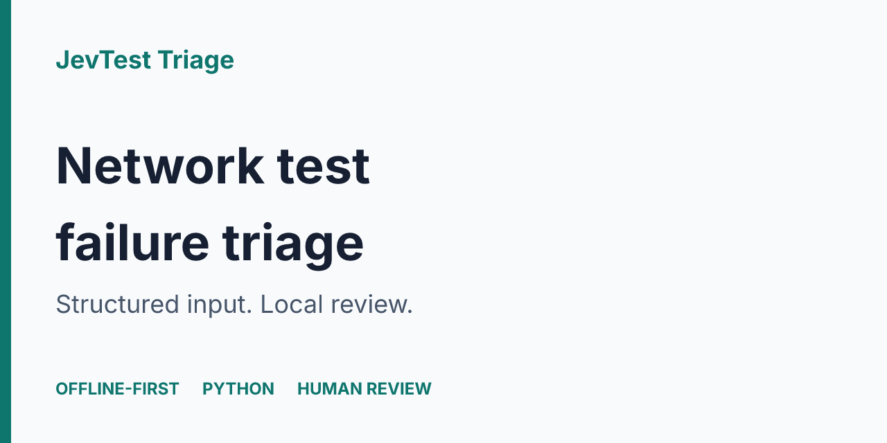
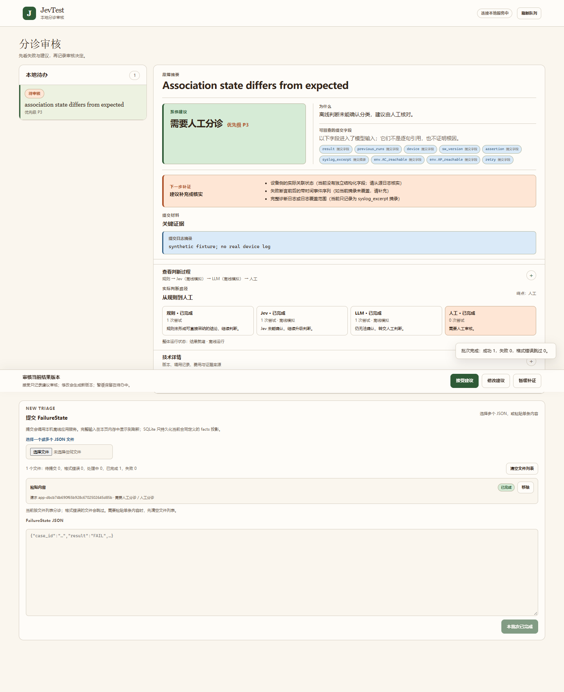

<h1 align="center">JevTest Triage</h1>
<p align="center">把网络设备自动化测试的失败材料，整理为可人工复核的分诊建议。</p>
<p align="center"></p>

输入一份已经发生的测试失败记录（FailureState JSON），得到失败类别、下一步动作、优先级、置信度和依据；在本地工作台查看判断路径、补充审核记录并接受、修正或暂缓建议。

## 能做什么

- **快速看一条失败**：命令行输出结构化建议，校验输入和输出契约。
- **保留判断过程**：Cascade 记录规则、Jev、LLM 的路由与尝试记录；SQLite 保存结果和审核历史。
- **人工复核**：网页支持导入 JSON、查看待办和证据、接受／修正／暂缓建议。
- **先离线体验**：默认网页使用规则、Jev mock 和 LLM stub，无需 API key。它验证操作流程，不证明真实模型的分诊效果。
- **可选接入**：提供 MCP STDIO 三个工具；Live Advisory 模式需要明确开启和单次确认。具体宿主接入和真实 API 效果需单独验证。

普通做法是把日志粘给聊天模型，再手工记录结论；JevTest 用固定的 FailureState／TriageResult 契约保留输入边界、路由和人工审核记录。它适合想验证失败分诊流程的测试工程师与开发者，目前仍是实验项目。

## 工作原理

```text
FailureState JSON
       |
       v
CLI / 本地 HTTP / MCP STDIO
       |
       v
契约校验 -> 应用服务 -> Cascade 分流 -> 分诊建议
                          |                |
                   Rule / Jev / LLM        v
                                    SQLite 持久化
                                          |
                                          v
                                    网页人工审核
```

图中是程序职责关系，不代表所有模块各自部署。单臂 CLI 可以直接运行规则；本地 HTTP／MCP 共用应用服务，可指定同一 SQLite 文件。

具体行为与首次使用流程见下文快速开始。程序没有持续监听服务，当前工作台通过导入 JSON 使用。

## 安装

需要 **Python 3.11 或更高版本**。本次本地核验环境是 Windows、Python 3.14；其他平台未在本次交付验证。依赖安装需要网络。

首次获取：解压配套源码包 `jevtest-0.1.0-source.zip`，进入解压后的项目根目录（含本 README 和 pyproject.toml）。创建虚拟环境：

```powershell
python -m venv .venv
.venv\Scripts\Activate.ps1
python -m pip install ".[web,mcp]"
```

macOS／Linux 激活命令为 `source .venv/bin/activate`；其余命令相同。若 PowerShell 不允许激活，可直接将下文的 `python` 换成 `.venv\Scripts\python.exe`。

也提供 wheel 安装包 `jevtest-0.1.0-py3-none-any.whl`：

```powershell
python -m pip install "./jevtest-0.1.0-py3-none-any.whl[web,mcp]"
```

wheel 含程序、网页和契约配置；示例与测试随源码包提供。首次使用建议选源码包，便于照着下面的路径执行。

## 快速开始

**1. 查看规则分诊结果。** 在项目根目录执行：

```powershell
python -m jevtest run examples/failure-example.json --arm rule
```

该合成样例应输出 `ENVIRONMENT`、`CHECK_ENVIRONMENT`、优先级 `3`，依据为环境不可达规则。`--arm rule` 只运行本地规则。

**2. 打开本地工作台。**

```powershell
python -m jevtest.http_api --host 127.0.0.1 --port 8765 --store runs/demo.sqlite3 --profile offline
```

保持终端运行，浏览器打开 [本地工作台](http://127.0.0.1:8765/)；服务此时处于 offline 模式，可在 /v1/health 确认；当前顶部徽标有已知显示问题，可能仍显示连接中。初次队列为空。复制 `examples/live-advisory-smoke.failure.json` 的完整 JSON 到导入区并提交；此处仍使用 offline 模式，文件名不启用真实 API。查看建议、判断路径和证据，选择接受／修正／暂缓，按页面提示填写审核人及确认文字。审核人是本地自报身份，不是组织身份认证。

停止服务按 `Ctrl+C`；再次使用相同命令和 SQLite 文件启动，已保存结果与审核历史可以继续读取。端口被占用时换一个空闲端口，并在浏览器打开对应地址。服务只支持本机回环地址。



该截图由本次隔离安装生成，内容为合成失败样例。无设备连接，也没有真实模型调用。

## 输入与输出

输入模型见 [FailureState 契约](contracts/failure-state.schema.json)，完整示例见 [failure-example.json](examples/failure-example.json)。保留 `case_id` 和 `provenance` 等必填字段；不要直接把任意日志当成合法 JSON。网页会先校验输入。

输出核心模型见 [TriageResult 契约](contracts/triage-result.schema.json)：`category`、`action`、`priority`、`confidence`、`reason`。`UNKNOWN`／`HUMAN_TRIAGE` 表示需要人工判断，不代表故障已经解决。应用外层还记录请求标识、执行模式、路由与审核状态。

修改审核不会重新评估模型置信度；它保留原值并注明未重估。人工接受建议不等于已经修复设备故障。

## 能力状态与限制

| 能力 | 当前状态 | 使用边界 |
|---|---|---|
| 单臂 CLI、合成 benchmark | 已实现 | 合成指标不能外推为企业效果 |
| Cascade、离线网页、SQLite 审核 | 已实现；本次安装验证 | mock／stub 只用于流程体验 |
| MCP STDIO | 已实现；本地进程测试 | 本次未配置或验证特定 Agent 宿主 |
| Live Advisory | 已接线；本次未调用真实 API | 需 key、显式开启、每条确认和人工审核；成本可为 unknown |
| 持续监听测试失败、完整排障简报 | 设计阶段 | 没有可用的持续监听服务 |
| 外部 Agent 交接执行、设备自动修复 | 未提供完整闭环 | 本地交接记录不证明外部执行 |
| H3C 专项效果、企业正式效果 | 未达到验证条件 | 历史专项记录为 10／15 严格唯一根因；正式效果验证待完成 |

当前规则基线缺少产品缺陷规则，不能作为通用故障定位器。请先脱敏输入：本地持久化会保存部分失败材料；真实 API 模式会向对应供应商发送 CommonFacts。系统不执行测试、不自动修 Bug，也不连接生产设备操作。

## 验证与开发

在同一虚拟环境中单独安装验证依赖：

```powershell
python -m pip install pytest
python -m pytest -q -m "not live"
```

源码包包含面向运行行为的离线回归测试；不携带内部 owner 活动、真实 API 历史数据库或研究语料测试。更多核验范围见 [验证说明](docs/verification.md)。

可自行生成并运行合成 smoke：

```powershell
python -m jevtest synthgen --seed 20260924 --out runs/synthetic.jsonl
python -m jevtest benchmark runs/synthetic.jsonl --limit 6 --sampling stratified --seed 0 --arms rule --out runs/smoke-rule
```

使用 `stratified` 防止只取到数据中同一类别块。6 条结果是流程 smoke，不是正式效果评估。

可选接口与配置见 [使用指南](docs/usage.md)，分发包内容见 [获取说明](docs/distribution.md)。

## 许可证

[MIT](LICENSE)。本地审核候选包含完整源码和使用说明；远端仓库与 Release 尚未发布。
