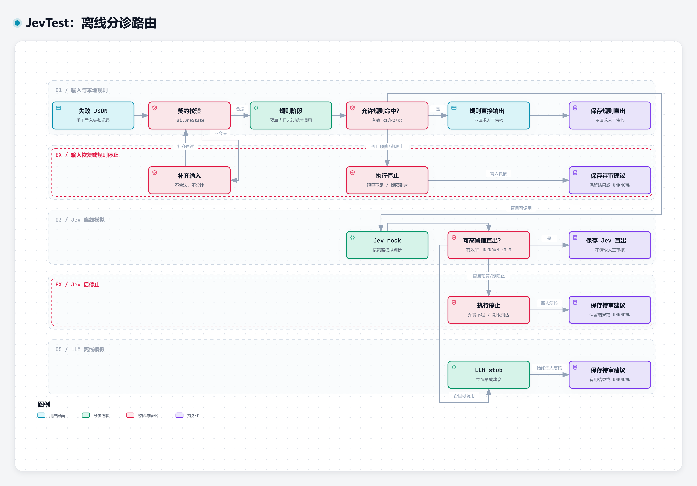
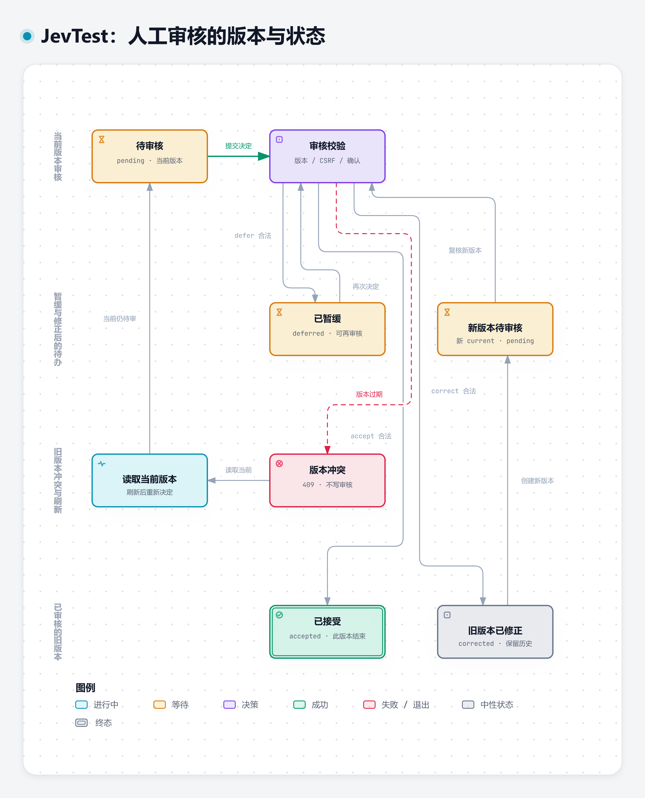

# 离线分诊与人工审核流程

[在线交互图](https://qq2743759880.github.io/jevtest/workflow.html) · [本地 HTML](workflow.html) · [可编辑 JSON](workflow.json) · [静态 SVG](../assets/workflow.svg)

输入完整 FailureState 后，HTTP 入口验证契约；不合法输入先补齐再试。合法输入进入离线 Cascade：策略允许的有效规则命中或高置信 mock 可以直出，其余继续 LLM stub 并进入人工审核。单阶段失败继续允许的后续阶段；超时/预算不足跳过调用。可用结果保留；完全无有效结果才使用 UNKNOWN / HUMAN_TRIAGE 兜底。

应用服务保存建议、路由、facts 投影和版本；需要人工时进入网页审核。接受、修正或暂缓必须提供当前版本、CSRF 和确认文字，冲突时刷新再试。SQLite 保留审核历史；接受建议不代表故障修复，修正不会重新评估置信度。

图表是上述流程的摘要，不是独立运行服务，不表示持续监听或设备操作。点击节点可以查看固定源码提交的证据；按 R 后依次点起点与终点查看有向路径；T 切换主题，E 打开导出菜单。默认是静态显示，路径交互只表示图中编写的连接。

HTML 自包含，可离线打开；在线版本由 GitHub Pages 托管。图表运行代码遵循 [Archify MIT 许可](ARCHIFY-LICENSE.txt)，嵌入字体遵循 [JetBrains Mono OFL](JetBrainsMono-OFL.txt)。

## 人工审核生命周期

[在线打开](https://qq2743759880.github.io/jevtest/audit-lifecycle.html) · [本地 HTML](audit-lifecycle.html) · [可编辑 JSON](audit-lifecycle.json) · [静态 SVG](../assets/audit-lifecycle.svg)

暂缓后同一版本仍可再次审核。修正会把旧版标记 corrected、生成新的 current/pending 版本并保留历史；新版本仍需复核。接受只结束该版本的审核，不表示故障已经修复。旧 If-Match 返回冲突，用户刷新读取当前状态后重新决定；图中刷新不是自动重试。

分诊图中多个保存节点表达不同结果路径，均写同一 SQLite，不是多个数据库。规则失败或无允许直出时，只要剩余预算和期限允许就继续 Jev；Jev 无有效高置信直出时同样继续 LLM。无有效结果时用 UNKNOWN / HUMAN_TRIAGE 兜底，已有结果保留。
